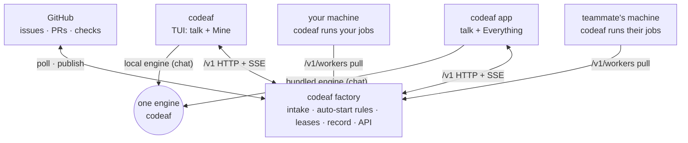
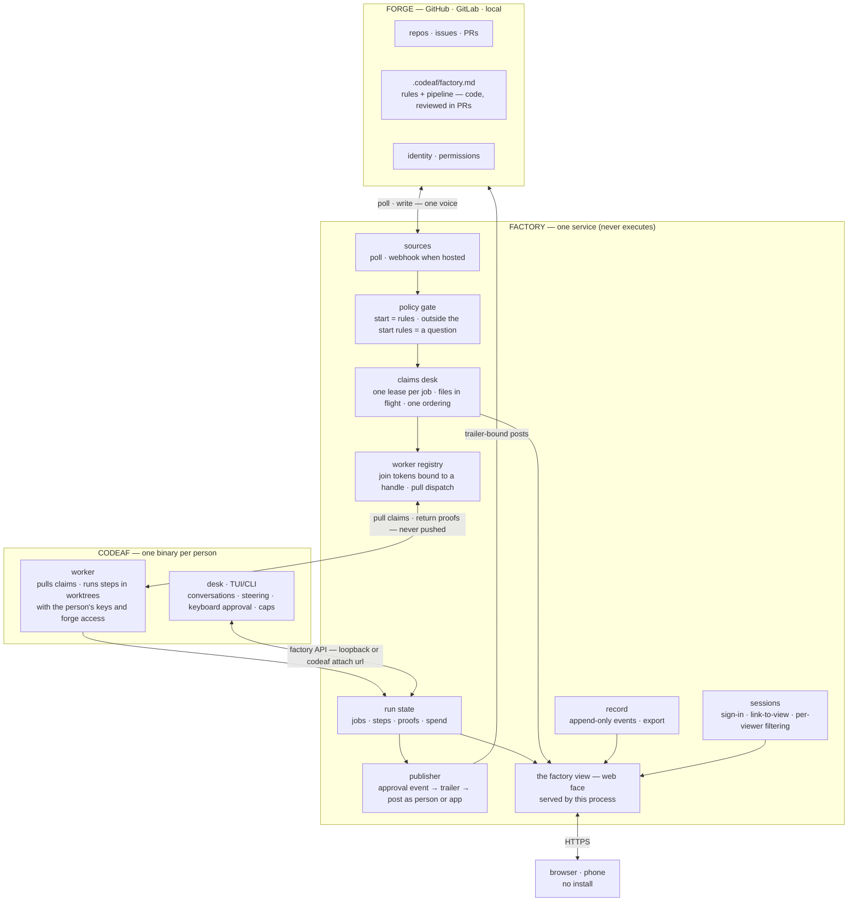
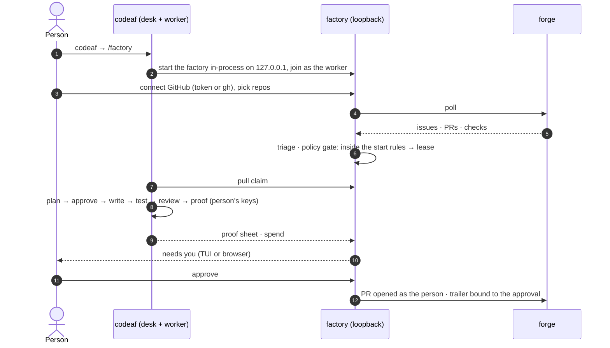
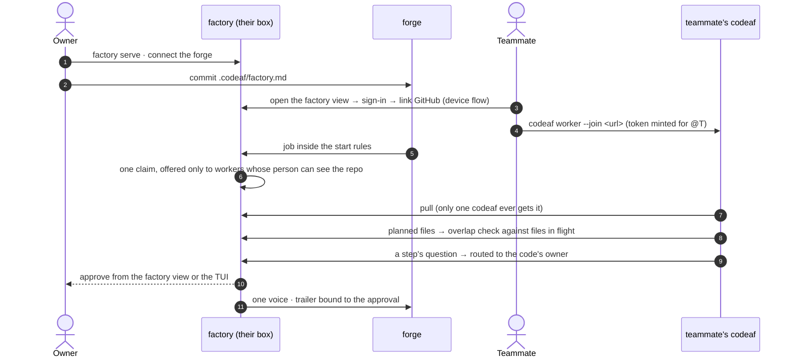
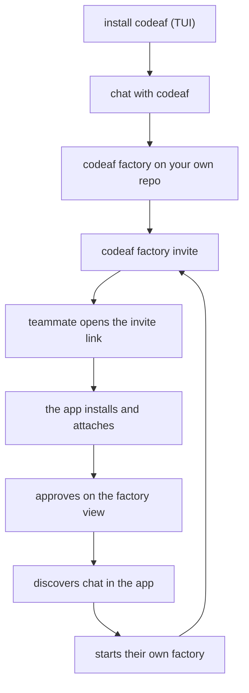
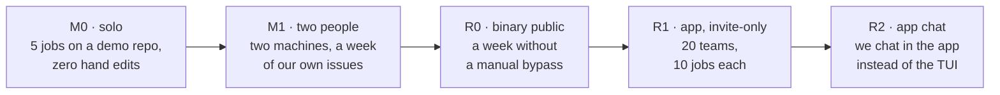

# The codeaf factory — product document

Status: goal agreed 2026-10-10; screens and open-source money model settled the same day (supersedes every earlier draft)
Scope: the factory service, its web face, and the factory-related changes to codeaf. Chat and personal tooling in codeaf are out of scope.

---

## 1. The goal

**Build the software factory: a service that turns a project's open work into reviewed pull requests automatically, under rules kept in the repo, with people judging outcomes instead of pressing go — and that works identically for one person on a laptop and for a company in the cloud.**

Two artifacts, nothing else:

| artifact | what it is | what it never does |
|---|---|---|
| **`factory`** | the service. Holds what is shared and scarce: claims, policy, routing of judgment, one voice on the forge, the record, continuity. Serves its own web face, the **factory view**. | execute work · hold code · hold accounts · hold money |
| **`codeaf`** | one binary a person installs. The **desk** (CLI + TUI: chat with a run, steer, approve at the keyboard) and the **worker** (pulls claims from a factory, runs them in worktrees with the person's own access and keys, returns proofs). | act outward on its own |

Same two artifacts in every deployment. The deployment decides capacity and reach, never features.

---

## 2. Why a center exists — the shared scarcities

Many people (or one person with several machines) running codeaf against one codebase break in known ways. Git and the forge solve none of them. The factory holds exactly these:

| scarcity | the factory holds | the problem it removes |
|---|---|---|
| **work** | one lease per job (one worker, expiry, re-queue); files in flight | two factories start the same issue; two change the same files blind |
| **policy** | one interpreter of `.codeaf/factory.md` | everyone's rules differ; automatic intake starts the wrong thing |
| **judgment** | questions routed to whoever owns that code, answerable by any qualified person | my factory asks me about code I do not own |
| **voice** | one presence on the forge; the trailer bound to the approval event | two bots talk on one issue; nobody can tell who approved |
| **memory** | the record (starts, approvals, publishes, overrides, spend per job); lessons proposed as PRs to the rules | a rejected PR's reason stays on one laptop |
| **attention** | one ordering; one pipeline view | nobody can see twelve jobs stuck at approve across four people |

**Who runs a job: its person, not a pool.** A job runs only on the machines of its person — the forge assignee, or whoever started it. Your codeaf takes other people's unassigned jobs only when you opted in (`codeaf attach --take-unassigned`). This keeps money personal, keeps presence quiet, and makes "assigned to me" mean what it already means on the forge.

**Money is not a shared scarcity in open source.** Every worker runs on a person's machine with that person's own model keys and forge access. Caps and the day rail are personal settings in codeaf. The factory only *records* what each job cost. A team budget needs one payer and one key, which is the hosted product.

Everything abundant — execution, worktrees, conversations, model calls — stays at the edge, in codeaf.

**Scope test for any feature:** does it govern a shared scarcity? Then it belongs to the factory. Otherwise it belongs to codeaf.

---

## 3. For one person

The factory at scale one is the same engine with a queue of one, a pool of one, an approver of one. No solo code path exists: solo is a factory at `127.0.0.1` with one worker and one viewer, and the TUI is its client like any other.

What a solo person gets, without being forced into anything:

- **Automatic intake.** Write once what may start (labels, size, cap, paths that never auto-start). Work begins without pressing go; you approve outcomes. Intake and polling need a service awake, not a window open.
- **Evidence, not text.** The factory view renders what the run produced: the proof sheet when the pipeline has a `proof` step (default on; the model may never skip it; a person may remove it from their pipeline), the diff, checks, log, spend.
- **Glance moments.** Any browser on the same network: what needs you, approve, answer, add work, reprioritize.
- **Breadth.** Pipeline across repos, what is stuck, spend over time, the record of what ran and what it cost.
- **Rules you can see.** The policy file rendered, with a dry run: "under these rules, these jobs would start today."
- **More than one machine.** Laptop and desktop run your codeaf against one factory and one claims desk — the solo form of the team problem.
- **Growth without migration.** A teammate points their codeaf at your factory's URL. Hosted is the same factory view with our machines in the pool.

What the factory does **not** give a solo laptop: continuity while the lid is closed. A sleeping machine runs nothing, factory or not. Continuity comes from where the factory and a worker run — an always-on box, a relay (its own branch), or hosted.

---

## 4. The design constraint — generic, bounded only by the agentic loop

The product fixes the primitives of the loop and nothing else; everything else is words the user writes.

| fixed, because the era demands it | open — words |
|---|---|
| a **job** runs an issue or PR through steps on a machine; a person judges the result | which steps, in what order |
| a **step** is a conversation with a model that has tools; it ends when the model says the step's condition holds | the prompt, the condition (`until`), the rounds (`max`) |
| a step reports in **markdown** and may assert **claims** with evidence | what it says, claims, what counts as evidence |
| a step may ask a **question**; a person answers | what it asks |
| **approve** is a person, always before anything leaves the machine | where approvals sit; which steps are `fixed` |
| **rules** are sentences every job obeys | the sentences |
| the factory keeps one job per worker, the record, and reads the forge | — |

No step kinds, no condition language, no block schema, no risk model, no plugin API. A security gate, a migration check, a performance budget, a docs step — each is a prompt, and its result shows up where every result shows up. The pipeline file is specified in `FACTORY-YAML.md`.

## 5. Surfaces: the binary and the app

**The binary is me and my machine; the app is us.** The TUI shows Mine; the app shows Everything. That is the one product-level difference, and it is deliberate, not a rendering limit. Team view is free in the app.

The public model is three lines:

- **codeaf** — a coding agent in your terminal. You talk, it works.
- **codeaf factory** — the same codeaf running your repo's work unattended, for you or your team. You approve.
- **codeaf app** — talk and factory in one window, for you and the people you work with.

One engine, one vocabulary. Nobody hears "worker", "control plane" or "mode": your codeaf is a worker when attached; that is plumbing.

Two verbs on one engine: **talk** (chat, steer, terminal) and **run** (factory: jobs that run unattended; you approve). Every surface can do both; they differ in what they are best at.



| responsibility | binary `codeaf` | app |
|---|---|---|
| chat with codeaf, steer, terminal | TUI — home | yes, same engine (bundled) |
| **my** jobs: take, approve, answer, steer, caps | TUI (Mine) | yes |
| **team**: everyone's jobs, who has what, needs-you across the team, proof media, the record | — | yes (Everything) |
| run the factory: GitHub intake, auto-start rules, leases, record, API | `codeaf factory` | — (attaches to one) |
| run jobs (be a worker) | yes | yes, via bundled engine, if the person turns it on |
| ops: attach, invite, repos, pipeline, revoke | CLI | attach + invite in UI; the rest read-only |
| policy | `.codeaf/factory.yaml` in the repo | read-only |

The app reaches this table at R2; R1 is the factory half.

Boundaries that never move:

- The TUI never grows team views, proof media or the record browser.
- The app never grows running a factory, editing policy, or ops.

**Capability rule:** anything you can say to codeaf, you can say in both; anything you need to see, you see in the app. Steering a job that runs on a teammate's machine is reply-level everywhere; deep steering happens on that machine.

### App R1 — the factory half

A `/v1` client (HTTP + SSE). No engine, no chat.

- **attach** — sign in to a factory through an invite link ("invited by") or URL + GitHub handle (device flow) or token.
- **factory view** — Mine / Unassigned / Everything; Needs you / Running / Queued / Backlog / Done; the record.
- **job thread** — the job brief with claims, proof media and diff summary; answer, approve, request changes, steer by reply. Reply-level on every job.
- **new job** — repo, title, text.
- **record** — what ran, who approved what, at what cost.
- **settings** — This factory (read-only) and You.
- **invites** — mint and share the link.

### App R2 — adds talk

- **general chat** — the TUI's chat, in a window, at TUI parity.
- **bundled engine** — the app ships `codeaf`, so my machine can be a worker and steering on my jobs gets full depth. It can put `codeaf` on PATH (like VS Code's `code`).
- **terminal** — the app's existing terminal tab.
- **opening rule** — the app opens on the factory view when attached, on chat when not. The invited teammate lands on work; the solo user lands on talk.

---

## 6. Screens

The screens below describe the factory view; the app renders it. The small page the factory itself serves is the same view and stands in until the app ships.

### 5.1 The factory view (served by `factory`; the app renders the same view)

| screen | shows | verbs | solo | team |
|---|---|---|---|---|
| **Sign-in** | "this factory is private" → factory token or tailnet; then "link your GitHub to view" (device flow) when watched repos differ in access | link · continue | never shown at loopback | first visit per device |
| **Queue** | since you last looked · pipeline strip (`plan 2 · approve 4 ⚑ · write 5 · review 1 · proof 2`) · groups Needs you / Queued / Running / Backlog / Done · repo chips · your capacity line (`2 queued for you · your laptop busy`) · the factory address | open · approve · answer · prioritize · drop · add | yes | filtered per viewer; a job says who it is assigned to and what it waits for (`waiting for @raj's worker (offline)`); no roster on the page |
| **Job** | header (kind, repo, number, title, state, holder) · step rail · tabs: proof · diff · checks · log · conversation · spend | approve · request changes · re-run checks · answer · reply · prioritize · drop | yes | the conversation shows who asked and who answered |
| **Add work** | repo · title · text → a `new` job | add | yes | yes |
| **Record** | what ran, who approved what, when, at what cost; export | export | yes | filtered per viewer |
| **Settings** | connect forge · watched repos · the pipeline file rendered + dry run ("these N would start today") · roster (members and workers by handle, online/offline — the only place presence is shown) · sessions · the factory's address and the attach command | connect · watch · (roster and sessions are read-only here; revoke is CLI) | yes | yes |

Phone-first, one column; on a wide screen the factory view becomes rows + a peek, like the TUI's 120-column layout. Every row, count, chip, event and export is computed *after* the viewer filter — aggregates leak as surely as diffs do.

### 5.2 The desk (codeaf TUI) — changes only

- The existing factory page stays; it becomes a client of the factory API. Locally it attaches to the loopback factory; `codeaf attach <url>` attaches to a team's.
- Settings gains one line: the factory it is attached to, and `join` when it is not yet a worker there.
- `codeaf factory serve` (and the `factory` alias) starts a service; `codeaf worker --join <url>` joins one; `factory sessions revoke @handle` and the other ops verbs are CLI only.
- Nothing is removed. Conversations, steering, keyboard approval stay where they are.

### 5.3 Uses

1. **Solo, day one.** Install codeaf → `/factory` → connect GitHub, pick repos → jobs stream in, triaged → `r` runs one, or `## start` starts it → approve the plan, approve the proof → the PR opens as you. Open `http://127.0.0.1:<port>` on the phone to approve from the couch.
2. **Solo, second machine.** `codeaf worker --join http://laptop:<port>` from the desktop. One factory, one claims desk; the desktop takes the next job.
3. **Team.** One person runs `factory serve` on a box, connects the forge, commits `.codeaf/factory.md`. Teammates open the factory view (sign-in, link GitHub), run `codeaf worker --join <url>`. Nobody takes the same job twice; a plan's file list warns of overlap; a question about billing goes to whoever owns billing.
4. **Judging from a phone.** A landed job shows its proof; approve as `@handle`; the factory posts with the trailer bound to that approval.
5. **A lesson.** A reviewer rejects a PR for a reason → the factory view offers "add to the rules" → a PR to `.codeaf/factory.md`.

---

## 7. Architecture



The contract in one line: **the factory decides and records; codeaf executes and converses; the factory view is where people judge.**

### Deployments

| deployment | factory runs on | workers are | reach |
|---|---|---|---|
| **solo** | your laptop, loopback | your codeaf, auto-joined | TUI; the factory view in a browser on your network |
| **team, self-hosted** | a box the team owns | teammates' codeafs, joined once, each with its person's keys | TUI with `codeaf attach <url>`; the factory view behind a sign-in |
| **hosted** (paid) | our infra, one tenant per company | cloud players + any registered machine; one payer, one key | the browser is enough |

Hosted changes capacity, tenancy and money — webhooks, always on, a pool that never sleeps, one team bill — never features.

### Repos, contract and versions

- **Two repos.** The codeaf repo holds the binary: engine, TUI, `codeaf factory`, `/v1`, the served page. The app repo holds the app only; it contains no engine code. Anything the app needs from the engine is added to the binary and exposed over `/v1` (or the local bridge at R2), never duplicated in the app.
- **The app moves out with its history.** A `git subtree split` of the app directory takes the app's existing code out of the codeaf repo's app branch. The engine changes on that branch stay in the codeaf repo and land on `dev` slice by slice for R2, bridge first.
- **The contract is the dependency.** The codeaf repo publishes the `/v1` types (today `internal/factory/api` and the served page's `types.ts`). The app pins a codeaf version and runs the contract test (fixture ≡ client → serve → fixture) against that version in its CI.
- **Bundling.** At R1 the app ships no binary. At R2 the app build downloads the pinned codeaf release by version and checksum and bundles it.
- **Version skew.** The factory reports its version and contract version on `/v1/me`. An app that is newer than the factory shows one line — "this factory runs codeaf X; update it to use Y" — and keeps the read-only views working. An older app keeps working against a newer factory because `/v1` only adds fields.
- **`factory/page` into `dev`.** It merges as a fast-forward once the open e2e tasks are done and the full suite is green. After that, factory work is ordinary `dev` work.

---

## 8. Identity and security

**No accounts, ever.** Identity, permissions and code live on the forge. The factory keeps sessions and credentials; the forge keeps people. The day the factory stores a password, an email, an invitation or a role we invented, the discipline broke.

**User = a forge handle. Team = the deployment.** One running factory is the team; there is no org object, no invitations, no roles. A second team runs a second factory.

The ladder, by deployment:

| | solo (loopback) | team (off loopback) |
|---|---|---|
| open the factory view | nothing | **sign-in**: tailnet, or one shared factory token |
| who am I | the factory already holds your forge token | **link the forge** once per device (device flow, read-only) → a session + a credential row keyed by `@handle` |
| what I see | everything | only repos *your* token can see (`GET /repos/{o}/{r}` × watched repos, cached with a short TTL); an optional `team:` allowlist in the **factory's host config** (never a repo's file) narrows further — admission = listed **and** visible |
| approvals | as you | as your handle, recorded as a bound event |
| worker | your codeaf, in-process credential | `codeaf worker --join <url>` with a join token minted **for a linked handle**; a claim is only offered to a worker whose person can see that repo |
| leaving | — | remove repo access on the forge → the next refresh empties their factory view; `factory sessions revoke @handle` drops the session; sessions expire |

Rules that hold everywhere:

- **Pulled, never pushed.** Workers dial out. The factory never opens a connection into any machine. A compromised factory view session can queue intent at worst.
- **Agents never attest.** Approvals are server-side events; the factory writes the trailer; publishing happens as the person (linked token) or the app (unattended, hosted).
- **Scope tag on everything.** Jobs, proofs (they contain diffs), logs, spend lines, events, notifications, counts, the pipeline strip, exports — every derived artifact carries its repo and passes the same one filter.
- **Token posture.** Self-hosted viewers' tokens are browser-held by default; hosted stores them encrypted and injects run secrets per run, never at rest.
- **Blast radius.** Ops verbs exist only in the CLI; the factory view holds no execution channel.

---

## 9. Policy

`.codeaf/factory.yaml`, committed and reviewed like code, read from the main branch (a PR can never change the rules for its own run). The full file is specified in `FACTORY-YAML.md`; in short:

```yaml
start:     # what may begin without a person: labels · size · cost · never paths · ask-first sentences
pipeline:  # the step names per kind of job: issue · pr · ci
steps:     # a step is a prompt (+ until, max); same name overrides a built-in
fixed:     # steps the job's manager may never drop
rules:     # sentences every job obeys
```

Two layers: **repo rules bind everyone; a personal `~/.codeaf/factory.yaml` may only be stricter.** Automatic inside what `start` allows; anything outside it — over a person's cap, `never` paths, `ask_first` matches, strangers' PRs — becomes a question, never a lease.

Two gates: **start = policy** (automatic), **publish = a person** (always).

The factory's own config lives on its host (`~/.codeaf/factory/config.yaml`: port, access, repos, optional member allowlist), edited by whoever runs the box.

## 10. Sequences

### 9.1 Solo — day one



### 9.2 Team — one factory, many codeafs



---

## 11. Business logic and strategy

**The goal now is user growth.** Revenue comes later. It only needs to stay possible: a hosted factory, memory, a relay, compute. Nothing we build now may close those doors, and nothing we build now waits for them.

**The delta over the forge is the product.** The forge holds artifacts: code, issues, PRs, identity, permissions. The factory holds what the forge has no concept of: live job state, leases, pending approvals, ordering, the record.

### Growth shape

1. **Acquire — the TUI.** One install, two reasons: chat, and "it does labeled issues while you are away" with `codeaf factory` on loopback.
2. **Spread — the factory is the multiplier.** One dev attaches a repo and invites a reviewer, a PM, a lead. They are not terminal people, so they need the app. The app's onboarding starts from "you were invited to @handle's factory", not from an empty chat.
3. **Retain — chat is the daily habit; the record and memory are the stake.**



### Invites

A factory invite is the app invite. It is a link that carries the factory address, a token and "invited by". It downloads the app, attaches it, and shows the queue. Invites are unlimited and minted by the factory owner (`codeaf factory invite`).

Nothing on the invited teammate's path is gated: no waitlist between an invite and the queue. Early access (signed builds, a waitlist for the first weeks) is for quality, not scarcity; a factory invite skips the line.

### Open and closed

Open or closed is a packaging decision. It can change at any time and it does not shape the product: there is one binary either way. A second binary would only ever follow a license split, never a product split. If we want exclusivity later, the hosted founding-teams program is the place for it.

### What would break the clean story

- A separate "factory app" brand or binary.
- A feature that lives only in the app for product reasons (a crippled terminal path).
- Different names for one thing across surfaces.
- A public app that never gets chat. (R1 is invite-only and factory-only on purpose; chat arrives at parity in R2.)
- A waitlist between the invited teammate and the queue.

---

## 12. Release plan

Three releases, in order. **R0** is the open binary with the factory merged, public first and alone. **R1** is the invite-only app as a pure factory controller: no chat, no bundled engine, a `/v1` client only. **R2** is chat in the app when it is at parity with the TUI, never at 60–70%. The invited app ships one thing done completely; the half-done chat stays on its branch behind a flag.

| | R0 — binary, open, `dev` | R1 — app, invite-only | R2 — app, chat |
|---|---|---|---|
| **has** | `codeaf` chat; `codeaf factory` (intake, start rules, yaml, leases, record, `/v1`, served page); `codeaf attach`; TUI factory view: Mine, take, approve, answer, caps; worker loop; `codeaf factory invite` | attach via invite link ("invited by"); Mine/Unassigned/Everything; Needs you/Running/Queued/Backlog/Done; job brief: claims, proof media, diff summary, thread (answer / approve / request changes / reply-steer); new job; record; Settings: This factory (read) / You; invites; signed builds + updater | general chat at TUI parity; bundled engine (my machine as a worker, deep steer on my jobs); terminal; opens on chat when not attached |
| **does not have** | team views (never) | chat, engine, terminal, policy editing, ops | — |
| **talks to** | GitHub, its own loopback or an attached factory | `/v1` only (HTTP + SSE) | `/v1` + local engine |
| **needs first** | the open e2e tasks + one week of dogfood | R0 public; the factory design implemented in the app shell with chat UI flagged off | the app branch's engine landed on `dev` (bridge first) |
| **gate to ship** | M1: two people, two machines, a week without a manual bypass | 20 hand-picked teams, nobody from us beside them, 10 jobs each | we use the app instead of the TUI for chat for a week |

**Chat in the invite app? No.** The test is "does a team run a factory". Chat does not test it. A 60% chat beside the existing chat apps would be the first thing reviewers write about. The job thread (answer, approve, request changes, steer by reply) is in R1: that is factory, not chat. Deep steering stays in the TUI.

**The TUI is public, with the factory merged, before R1.** The binary is what the team runs: `codeaf factory` on one machine, `codeaf` + `attach` on each dev's. Without it the app has nothing to attach to. R0 two to four weeks before R1 hardens leases and intake on strangers' repos before the app's first impression depends on them.

**The app as controller has less than the TUI in one way and more in another.** The TUI has Mine and deep steering. The app has Everything, proof, the record and invites. Neither is a subset. Open users without the app see their team through GitHub and the factory's small served page. That is acceptable for the test phase.

**Why R1 without the engine is the simplification.** A pure `/v1` client needs none of the app branch's engine code, so landing that code on `dev` leaves the critical path. R1 = the existing app shell + the factory design + the `/v1` client already written for the served page (`types.ts`, the API client and the SSE hook are shared). Chat and the bridge continue on the branch toward R2.

### Who needs what, by release

The factory never executes; a job runs on its person's machine. So what each person installs depends on what they do, not on the release alone.

| person | R1 | R2 | cloud (later) |
|---|---|---|---|
| **deploys the factory** (one person per team) | the binary: `codeaf factory` on a reachable machine (laptop on the tailnet, or a server / Docker image) | same | nobody — we host it |
| **takes jobs** (a dev) | app + binary: `codeaf attach` on their laptop makes it their worker; deep steering and talking to a job's manager happen in the TUI | app alone: the bundled engine is the worker; chat at TUI parity; the TUI remains a preference | app alone; our workers run the job |
| **approves, answers, reviews** (reviewer, PM, lead) | app alone | app alone | app alone |

In R1 the app has the job thread (answer, approve, request changes, reply-steer); deep steering is in the TUI, where the dev already is because their jobs run there. After R2 the app is a superset of the TUI in what a person can see and do; running the factory, policy (`.codeaf/factory.yaml`) and ops stay with the binary by design. "App alone, nothing on the laptop" needs the relay/remote-worker work plus one new wire: the job's conversation then lives on our worker, so deep steering travels through the factory instead of the local engine — the single new wire between R2 and cloud.

### Gates, in order

A gate is a journey that works end to end, not a set of components. Every gate exits after a week of dogfood without a manual bypass.



- **M0 — solo, one laptop.** Factory + TUI. 5 jobs on a demo repo become PRs with zero hand edits.
- **M1 — two people, two machines.** One factory; leases hold. One week on the CodeAF repo's own issues.
- **R0 — the binary is public.** After M1 and the open e2e tasks.
- **R1 — the app, invite-only.** 20 hand-picked teams, 10 jobs each, nobody from us beside them.
- **R2 — chat parity.** We use the app instead of the TUI for chat for a week.

The one number: jobs completed through the factory per week. After R1, teams attached and active at day 30.

---

## 13. Nomenclature

| term | meaning |
|---|---|
| **factory** | the service; also the product |
| **factory view** | the factory's web face; the app and the TUI's factory page render the same view |
| **codeaf** | the person's binary: desk + worker |
| **desk** | the TUI/CLI side of codeaf |
| **worker** | the executing side of codeaf; pulls claims; runs with its person's keys |
| **job** | a unit of work: issue, PR, red CI run, chore, or work a chat split off |
| **lease** | one worker's hold on a job; in the UI: *taken by* / *Take* |
| **claim** | a statement a step asserts with evidence; what a person approves |
| **start rules** | what `start` lets begin without a person |
| **pipeline** | the steps a job runs, in order; a step is a prompt |
| **sign-in** | what a browser needs off loopback: tailnet or a factory token |
| **link** | a viewer's one-time read-only forge link → session + credential row keyed by handle |
| **record** | the append-only event log |

---

## 14. Not the product

A forge replacement. A platform for others to build on. A chat app in the browser. A notification inbox. A per-seat SaaS. A team budget in open source.

## 15. Open

- **One codeaf attaches to one factory at a time.** Personal repos while attached to a team's factory means `codeaf detach`, or a second factory later. Multi-factory is a later point, not this branch.

- Factory view conversation depth: reply-level now; deep steering stays in the TUI.
- Local env for self-hosted runs: documentation and tooling, or managed env as hosted-only.
- Notifications: web push + digest first; every notification carries a scope tag.
- Hosted only: per-run injection of push credentials and model keys for machines nobody owns.
- `codeaf worker --join` is kept (easy join; the moat is after the join); revisit if headless self-run capacity proves to erode hosted.
