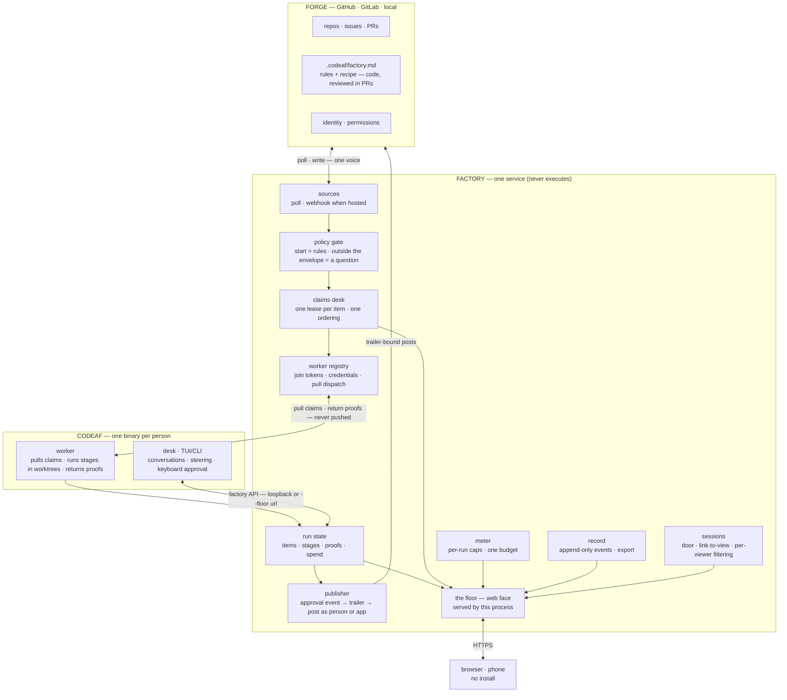
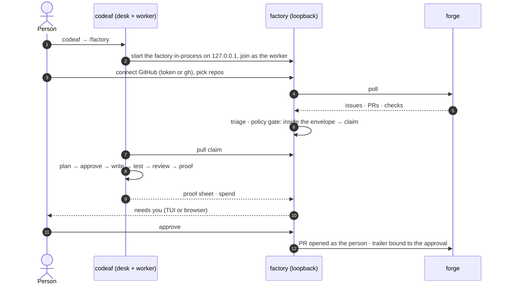
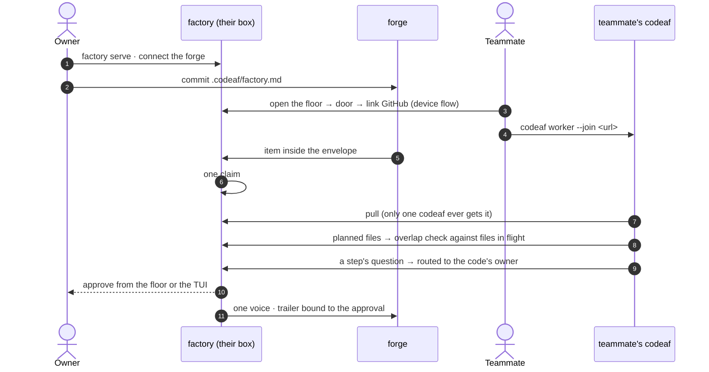
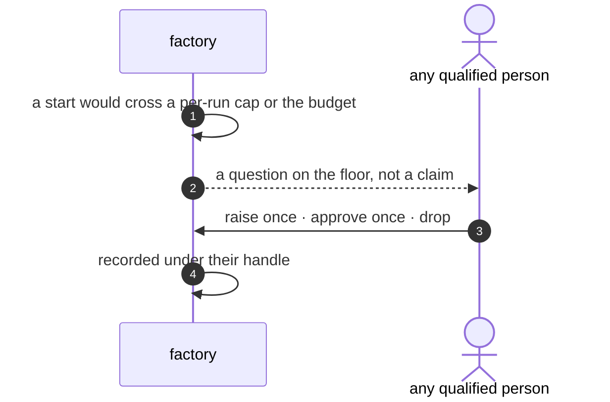

# The CodeAF Factory — product document

Status: goal agreed 2026-10-10 (supersedes every earlier draft)
Scope: the factory service, its web face, and the factory-related changes to codeaf. Chat and personal tooling in codeaf are out of scope.

---

## 1. The goal

**Build the software factory: a service that turns a project's open work into reviewed pull requests automatically, under rules kept in the repo, with people judging outcomes instead of pressing go — and that works identically for one person on a laptop and for a company in the cloud.**

Two artifacts, nothing else:

| artifact | what it is | what it never does |
|---|---|---|
| **`factory`** | the service. Holds what is shared and scarce: claims, policy, the meter, routing of judgment, one voice on the forge, the record, continuity. Serves its own web face, the **floor**. | execute work · hold code · hold accounts |
| **`codeaf`** | one binary a person installs. The **desk** (CLI + TUI: chat with a run, steer, approve at the keyboard) and the **worker** (pulls claims from a factory, runs them in worktrees, returns proofs). | act outward on its own · hold the forge token for the team |

Same two artifacts in every deployment. The deployment decides capacity and reach, never features.

---

## 2. Why a center exists — the shared scarcities

Many people (or one person with several machines) running codeaf against one codebase break in known ways. Git and the forge solve none of them. The factory holds exactly these:

| scarcity | the factory holds | the problem it removes |
|---|---|---|
| **work** | one claim per item, with expiry and re-queue | two factories start the same issue; two change the same files blind |
| **policy** | one interpreter of `.codeaf/factory.md` | everyone's rules differ; automatic intake starts the wrong thing |
| **money** | one meter; caps crossed become questions, never claims | each laptop has its own limit; nobody holds the team budget |
| **judgment** | questions routed to whoever owns that code, answerable by any qualified person | my factory asks me about code I do not own |
| **voice** | one presence on the forge; the trailer bound to the approval event | two bots talk on one issue; nobody can tell who approved |
| **memory** | the record (starts, approvals, publishes, overrides, cost); lessons proposed as PRs to the rules | a rejected PR's reason stays on one laptop |
| **attention** | one ordering; one pipeline view | nobody can see twelve items stuck at approve across four people |

Everything abundant — execution, worktrees, conversations, model calls — stays at the edge, in codeaf.

**Scope test for any feature:** does it govern a shared scarcity? Then it belongs to the factory. Otherwise it belongs to codeaf.

---

## 3. For one person

The factory at scale one is the same engine with a queue of one, a pool of one, an approver of one. No solo code path exists: solo is a factory at `127.0.0.1` with one worker and one viewer, and the TUI is its client like any other.

What a solo person gets from the factory, without being forced into anything:

- **Automatic intake.** Write once what may start (labels, size, cap, paths that never auto-start). Work begins without pressing go; you approve outcomes. Intake and polling need a service awake, not a window open.
- **Evidence, not text.** The floor renders what the run produced: the proof sheet when the recipe has a `proof` stage (default on; the model may never skip it; a person may remove it from their recipe), the diff, checks, log, spend.
- **Glance moments.** Any browser on the same network: what needs you, approve, answer, add work, reprioritize.
- **Breadth.** Pipeline across repos, what is stuck, spend today and over time, the record of what ran and what it cost.
- **Rules you can see.** The policy file rendered, with a dry run: "under these rules, these items would start today."
- **More than one machine.** Laptop and desktop are two workers on one floor, one meter, one claims desk — the solo form of the team problem.
- **Growth without migration.** A teammate points their codeaf at your factory's URL. Hosted is the same floor with our machines in the pool.

What the factory does **not** give a solo laptop: continuity while the lid is closed. A sleeping machine runs nothing, factory or not. Continuity comes from where the factory and a worker run — an always-on box, a relay (its own branch), or hosted.

---

## 4. Surfaces — the desk and the wall

| | **desk** — codeaf TUI | **wall** — the factory's floor (browser) |
|---|---|---|
| is for | working inside one item | looking and deciding across items, machines, people, time |
| holds | every conversation: the manager, step chats, steering; logs; keyboard approval | floor sections, item page with proof and evidence, pipeline, spend, record, roster, capacity |
| verbs | all of them | judgment only: approve · answer · add · prioritize · drop |
| not here | — | process control · machine administration · policy editing · rich chat |

The line:

- **Conversation lives in the TUI.** The wall takes reply-level answers to questions only.
- **Policy lives in git.** The wall renders and dry-runs `.codeaf/factory.md`; it never edits it.
- **Operations live in the CLI** (`factory serve`, connect, join). A stolen browser session can judge, never administer or execute.
- **The floor is not an inbox.** "Needs you" is the list of gates the policy created (approve steps, cap questions, step questions) — the same group the TUI floor already shows. No feed, no read marks.

---

## 5. Architecture



The contract in one line: **the factory decides and records; codeaf executes and converses; the floor is where people judge.**

### Deployments

| deployment | factory runs on | workers are | reach |
|---|---|---|---|
| **solo** | your laptop, loopback | your codeaf, auto-joined | TUI; the floor in a browser on your network |
| **team, self-hosted** | a box the team owns | teammates' codeafs, joined once | TUI with `--floor <url>`; the floor behind a door |
| **hosted** (paid) | our infra, one tenant per company | cloud players + any registered machine | the browser is enough |

Hosted changes capacity and tenancy — webhooks, always on, a pool that never sleeps — never features.

---

## 6. Identity and security

**No accounts, ever.** Identity, permissions and code live on the forge. The factory keeps sessions and credentials; the forge keeps people. The day the factory stores a password, an email, an invitation or a role we invented, the discipline broke.

The ladder, by deployment:

| | solo (loopback) | team (off loopback) |
|---|---|---|
| open the floor | nothing | **door**: tailnet, or one shared floor token |
| who am I | the factory already holds your forge token | **link the forge** once (device flow, read-only) → a session + a credential row keyed by handle |
| what I see | everything | filtered by *your* forge permissions (`GET /repos/{o}/{r}` with your token, cached, refreshed on the poll cycle); optional allowlist in the policy file (`team: [gh:priya, …]`), admission = listed **and** visible |
| approvals | as you | as your handle, recorded as a bound event |
| worker | your codeaf, in-process credential | `codeaf worker --join <url>` with a one-time join token → a worker credential kept on that machine |

Rules that hold everywhere:

- **Pulled, never pushed.** Workers dial out. The factory never opens a connection into any machine. A compromised floor session can queue intent at worst.
- **Agents never attest.** Approvals are server-side events; the factory writes the trailer; publishing happens as the person (linked token) or the app (unattended).
- **Token posture.** Self-hosted viewers' tokens are browser-held by default; hosted stores them encrypted and injects run secrets per run, never at rest.
- **Visibility is enforced at the view, not the store.** One shared floor; nothing a browser receives is secret.
- **Blast radius.** Ops verbs exist only in the CLI; the floor holds no execution channel.

---

## 7. Policy and money

`.codeaf/factory.md`, committed and reviewed like code, read from the main branch (a PR can never change the law for its own review):

```
## start        — what may begin without a person: labels · size · per-run cap · never-auto paths
## steps        — the recipe per item kind: plan · approve · write · test · review · security · proof
## rules        — fixed stages and policy sentences (tests pass before anything posts, …)
## team         — optional allowlist of forge handles; one budget for everyone
```

Two layers: **repo rules bind everyone; a personal file may only be stricter.** Automatic inside the envelope the team defined; anything outside it — money, risky paths, strangers' PRs — becomes a question on the floor, never a claim.

Two gates: **start = policy** (automatic), **publish = a person** (always).

---

## 8. Sequences

### 8.1 Solo — day one



### 8.2 Team — one factory, many codeafs



### 8.3 The meter



---

## 9. Business logic and strategy

**The delta over the forge is the product.** The forge holds artifacts: code, issues, PRs, identity, permissions. The factory holds what the forge has no concept of: live run state, claims, pending approvals, spend rails, ordering, the record.

**Open is complete.** One binary, self-hostable, forge-neutral; whatever works on localhost ships open. The open factory is the audience engine: `factory.md` in repos, the trailer on every PR the factory touched, shareable proof sheets. No paid tier at launch.

**Paid is one product: the factory, hosted.** Our service, always on, webhooks, cloud players in the pool, metered inside it. The assignee becomes a judgment role: approve from a browser, no machine needed. The hybrid — rent cloud players for a self-hosted floor — is the bridge, the first dollar from existing self-hosters, and the sovereignty answer.

**The moat is the night shift, not the join.** Registering a machine is one command (as it is for any CI runner). What is hard is keeping machines awake, patched, env-managed and secrets-clean; pull-only workers mean self-run capacity is a full ops burden. We sell ops and compute, never features, never login.

**The honest nudge is a fact the open floor shows itself:** `2 items queued · no workers online — a cloud player would have started them by now.`

---

## 10. Rollout

1. **This branch — solo on one laptop.** The factory as a loopback service; the TUI rewired as a client of the factory API (today the floor is disabled over `--host`/`--at` and reads the store in-process); the floor at localhost: sections, item page with evidence, judgment verbs, pipeline, spend, record, policy dry-run; the claims desk replacing `run.lock` and the file mailbox; automatic intake from `## start`; the append-only record with bound approval events.
2. **Service packaging.** `factory serve`, door, deploy notes, forge connect from the browser.
3. **Team reach.** Link-to-view sessions, per-viewer filtering, worker join, overlap warnings, routed questions, the team meter.
4. **Compute.** Relay and personal pools — its own branch.
5. **Hosted.** Tenant credential, metering, webhooks, cloud players, hybrid attach, GitHub App identity.

---

## 11. Nomenclature

| term | meaning |
|---|---|
| **factory** | the service; also the product |
| **floor** | the factory's web face (and the name of the TUI page that shows the same floor) |
| **codeaf** | the person's binary: desk + worker |
| **desk** | the TUI/CLI side of codeaf |
| **worker** | the executing side of codeaf; pulls claims |
| **item** | a unit of work: issue, PR, red CI run, chore, or work a chat split off |
| **claim** | one worker's lease on an item |
| **envelope** | what `## start` lets begin without a person |
| **door** | what a browser needs off loopback: tailnet or a floor token |
| **link** | a viewer's one-time read-only forge link → session + credential row |
| **record** | the append-only event log |

---

## 12. Not the product

A forge replacement. A platform for others to build on. A chat app in the browser. A notification inbox. A per-seat SaaS.

## 13. Open

- Secrets for runs on teammate machines: injection with the same discipline as hosted.
- Floor conversation depth: reply-level now; deep steering stays in the TUI.
- Local env for self-hosted runs: documentation and tooling, or managed env as hosted-only.
- Notifications: web push + digest first.
- `codeaf worker --join` is kept (easy join, moat is after the join); revisit if headless self-run capacity proves to erode hosted.
