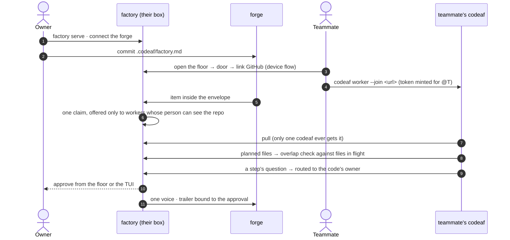

# The CodeAF Factory — product document

Status: goal agreed 2026-10-10; screens and open-source money model settled the same day (supersedes every earlier draft)
Scope: the factory service, its web face, and the factory-related changes to codeaf. Chat and personal tooling in codeaf are out of scope.

---

## 1. The goal

**Build the software factory: a service that turns a project's open work into reviewed pull requests automatically, under rules kept in the repo, with people judging outcomes instead of pressing go — and that works identically for one person on a laptop and for a company in the cloud.**

Two artifacts, nothing else:

| artifact | what it is | what it never does |
|---|---|---|
| **`factory`** | the service. Holds what is shared and scarce: claims, policy, routing of judgment, one voice on the forge, the record, continuity. Serves its own web face, the **floor**. | execute work · hold code · hold accounts · hold money |
| **`codeaf`** | one binary a person installs. The **desk** (CLI + TUI: chat with a run, steer, approve at the keyboard) and the **worker** (pulls claims from a factory, runs them in worktrees with the person's own access and keys, returns proofs). | act outward on its own |

Same two artifacts in every deployment. The deployment decides capacity and reach, never features.

---

## 2. Why a center exists — the shared scarcities

Many people (or one person with several machines) running codeaf against one codebase break in known ways. Git and the forge solve none of them. The factory holds exactly these:

| scarcity | the factory holds | the problem it removes |
|---|---|---|
| **work** | one claim per item, with expiry and re-queue; files in flight | two factories start the same issue; two change the same files blind |
| **policy** | one interpreter of `.codeaf/factory.md` | everyone's rules differ; automatic intake starts the wrong thing |
| **judgment** | questions routed to whoever owns that code, answerable by any qualified person | my factory asks me about code I do not own |
| **voice** | one presence on the forge; the trailer bound to the approval event | two bots talk on one issue; nobody can tell who approved |
| **memory** | the record (starts, approvals, publishes, overrides, spend per item); lessons proposed as PRs to the rules | a rejected PR's reason stays on one laptop |
| **attention** | one ordering; one pipeline view | nobody can see twelve items stuck at approve across four people |

**Who runs a job: its person, not a pool.** A job runs only on the machines of its person — the forge assignee, or whoever started it. A worker takes other people's unassigned jobs only when its owner opted in (`codeaf attach --take-unassigned`). This keeps money personal, keeps presence quiet, and makes "assigned to me" mean what it already means on the forge.

**Money is not a shared scarcity in open source.** Every worker runs on a person's machine with that person's own model keys and forge access. Caps and the day rail are personal settings in codeaf. The factory only *records* what each item cost. A team budget needs one payer and one key, which is the hosted product.

Everything abundant — execution, worktrees, conversations, model calls — stays at the edge, in codeaf.

**Scope test for any feature:** does it govern a shared scarcity? Then it belongs to the factory. Otherwise it belongs to codeaf.

---

## 3. For one person

The factory at scale one is the same engine with a queue of one, a pool of one, an approver of one. No solo code path exists: solo is a factory at `127.0.0.1` with one worker and one viewer, and the TUI is its client like any other.

What a solo person gets, without being forced into anything:

- **Automatic intake.** Write once what may start (labels, size, cap, paths that never auto-start). Work begins without pressing go; you approve outcomes. Intake and polling need a service awake, not a window open.
- **Evidence, not text.** The floor renders what the run produced: the proof sheet when the recipe has a `proof` stage (default on; the model may never skip it; a person may remove it from their recipe), the diff, checks, log, spend.
- **Glance moments.** Any browser on the same network: what needs you, approve, answer, add work, reprioritize.
- **Breadth.** Pipeline across repos, what is stuck, spend over time, the record of what ran and what it cost.
- **Rules you can see.** The policy file rendered, with a dry run: "under these rules, these items would start today."
- **More than one machine.** Laptop and desktop are two workers on one floor and one claims desk — the solo form of the team problem.
- **Growth without migration.** A teammate points their codeaf at your factory's URL. Hosted is the same floor with our machines in the pool.

What the factory does **not** give a solo laptop: continuity while the lid is closed. A sleeping machine runs nothing, factory or not. Continuity comes from where the factory and a worker run — an always-on box, a relay (its own branch), or hosted.

---

## 4. The design constraint — generic, bounded only by the agentic loop

The product fixes the primitives of the loop and nothing else; everything else is words the user writes.

| fixed, because the era demands it | open — words |
|---|---|
| a **job** runs an issue or PR through steps on a machine; a person judges the result | which steps, in what order |
| a **step** is a conversation with a model that has tools; it ends when the model says the step's condition holds | the prompt, the condition (`until`), the rounds (`max`) |
| a step reports in **markdown** and may assert **claims** with evidence | what it says, claims, what counts as evidence |
| a step may ask a **question**; a person answers | what it asks |
| **approve** is a person, always before anything leaves the machine | where approvals sit; which steps are `fixed` |
| **rules** are sentences every job obeys | the sentences |
| the factory keeps one job per worker, the record, and reads the forge | — |

No step kinds, no condition language, no block schema, no risk model, no plugin API. A security gate, a migration check, a performance budget, a docs step — each is a prompt, and its result shows up where every result shows up. The pipeline file is specified in `FACTORY-YAML.md`.

## 5. Surfaces — the desk and the wall

| | **desk** — codeaf TUI | **wall** — the factory's floor (browser) |
|---|---|---|
| is for | working inside one item | looking and deciding across items, machines, people, time |
| holds | every conversation: the manager, step chats, steering; logs; keyboard approval | floor sections, item page with proof and evidence, pipeline, record, roster, capacity |
| verbs | all of them | judgment only: approve · request changes · answer · add · prioritize · drop |
| not here | — | process control · machine administration · policy editing · rich chat · money settings |

The line:

- **Conversation lives in the TUI.** The wall takes reply-level answers to questions only.
- **Policy lives in git.** The wall renders and dry-runs `.codeaf/factory.md`; it never edits it.
- **Money lives in codeaf.** Caps and the day rail are the person's; the wall shows spend, never sets it.
- **Operations live in the CLI** (`factory serve`, connect, join, sessions). A stolen browser session can judge, never administer or execute.
- **The floor is not an inbox.** "Needs you" is the list of gates the policy created (approve steps, cap questions, step questions) — the same group the TUI floor already shows. No feed, no read marks.

---

## 6. Screens

### 5.1 The floor (browser, served by `factory`)

| screen | shows | verbs | solo | team |
|---|---|---|---|---|
| **Door** | "this floor is private" → floor token or tailnet; then "link your GitHub to view" (device flow) when watched repos differ in access | link · continue | never shown at loopback | first visit per device |
| **Queue** | since you last looked · pipeline strip (`plan 2 · approve 4 ⚑ · write 5 · review 1 · proof 2`) · groups Needs you / Queued / Running / Backlog / Done · repo chips · your capacity line (`2 queued for you · your laptop busy`) · the factory address | open · approve · answer · prioritize · drop · add | yes | filtered per viewer; a job says who it is assigned to and what it waits for (`waiting for @raj's worker (offline)`); no roster on the page |
| **Item** | header (kind, repo, number, title, state, holder) · stage rail · tabs: proof · diff · checks · log · conversation · spend | approve · request changes · re-run checks · answer · reply · prioritize · drop | yes | the conversation shows who asked and who answered |
| **Add work** | repo · title · text → a `new` item | add | yes | yes |
| **Record** | what ran, who approved what, when, at what cost; export | export | yes | filtered per viewer |
| **Settings** | connect forge · watched repos · the pipeline file rendered + dry run ("these N would start today") · roster (members and workers by handle, online/offline — the only place presence is shown) · sessions · the factory's address and the attach command | connect · watch · (roster and sessions are read-only here; revoke is CLI) | yes | yes |

Phone-first, one column; on a wide screen the floor becomes rows + a peek, like the TUI's 120-column layout. Every row, count, chip, event and export is computed *after* the viewer filter — aggregates leak as surely as diffs do.

### 5.2 The desk (codeaf TUI) — changes only

- The existing factory page stays; it becomes a client of the factory API. Locally it attaches to the loopback factory; `codeaf --floor <url>` attaches to a team's.
- Settings gains one line: the factory it is attached to, and `join` when it is not yet a worker there.
- `codeaf factory serve` (and the `factory` alias) starts a service; `codeaf worker --join <url>` joins one; `factory sessions revoke @handle` and the other ops verbs are CLI only.
- Nothing is removed. Conversations, steering, keyboard approval stay where they are.

### 5.3 Uses

1. **Solo, day one.** Install codeaf → `/factory` → connect GitHub, pick repos → items stream in, triaged → `r` runs one, or `## start` starts it → approve the plan, approve the proof → the PR opens as you. Open `http://127.0.0.1:<port>` on the phone to approve from the couch.
2. **Solo, second machine.** `codeaf worker --join http://laptop:<port>` from the desktop. One floor, one claims desk; the desktop takes the next item.
3. **Team.** One person runs `factory serve` on a box, connects the forge, commits `.codeaf/factory.md`. Teammates open the floor (door, link GitHub), run `codeaf worker --join <url>`. Nobody takes the same item twice; a plan's file list warns of overlap; a question about billing goes to whoever owns billing.
4. **Judging from a phone.** A landed item shows its proof; approve as `@handle`; the factory posts with the trailer bound to that approval.
5. **A lesson.** A reviewer rejects a PR for a reason → the floor offers "add to the rules" → a PR to `.codeaf/factory.md`.

---

## 7. Architecture


The contract in one line: **the factory decides and records; codeaf executes and converses; the floor is where people judge.**

### Deployments

| deployment | factory runs on | workers are | reach |
|---|---|---|---|
| **solo** | your laptop, loopback | your codeaf, auto-joined | TUI; the floor in a browser on your network |
| **team, self-hosted** | a box the team owns | teammates' codeafs, joined once, each with its person's keys | TUI with `--floor <url>`; the floor behind a door |
| **hosted** (paid) | our infra, one tenant per company | cloud players + any registered machine; one payer, one key | the browser is enough |

Hosted changes capacity, tenancy and money — webhooks, always on, a pool that never sleeps, one team bill — never features.

---

## 8. Identity and security

**No accounts, ever.** Identity, permissions and code live on the forge. The factory keeps sessions and credentials; the forge keeps people. The day the factory stores a password, an email, an invitation or a role we invented, the discipline broke.

**User = a forge handle. Team = the deployment.** One running factory is the team; there is no org object, no invitations, no roles. A second team runs a second factory.

The ladder, by deployment:

| | solo (loopback) | team (off loopback) |
|---|---|---|
| open the floor | nothing | **door**: tailnet, or one shared floor token |
| who am I | the factory already holds your forge token | **link the forge** once per device (device flow, read-only) → a session + a credential row keyed by `@handle` |
| what I see | everything | only repos *your* token can see (`GET /repos/{o}/{r}` × watched repos, cached with a short TTL); an optional `team:` allowlist in the **factory's host config** (never a repo's file) narrows further — admission = listed **and** visible |
| approvals | as you | as your handle, recorded as a bound event |
| worker | your codeaf, in-process credential | `codeaf worker --join <url>` with a join token minted **for a linked handle**; a claim is only offered to a worker whose person can see that repo |
| leaving | — | remove repo access on the forge → the next refresh empties their floor; `factory sessions revoke @handle` drops the session; sessions expire |

Rules that hold everywhere:

- **Pulled, never pushed.** Workers dial out. The factory never opens a connection into any machine. A compromised floor session can queue intent at worst.
- **Agents never attest.** Approvals are server-side events; the factory writes the trailer; publishing happens as the person (linked token) or the app (unattended, hosted).
- **Scope tag on everything.** Items, proofs (they contain diffs), logs, spend lines, events, notifications, counts, the pipeline strip, exports — every derived artifact carries its repo and passes the same one filter.
- **Token posture.** Self-hosted viewers' tokens are browser-held by default; hosted stores them encrypted and injects run secrets per run, never at rest.
- **Blast radius.** Ops verbs exist only in the CLI; the floor holds no execution channel.

---

## 9. Policy

`.codeaf/factory.yaml`, committed and reviewed like code, read from the main branch (a PR can never change the rules for its own run). The full file is specified in `FACTORY-YAML.md`; in short:

```yaml
start:     # what may begin without a person: labels · size · cost · never paths · ask-first sentences
pipeline:  # the step names per kind of job: issue · pr · ci
steps:     # a step is a prompt (+ until, max); same name overrides a built-in
fixed:     # steps the job's manager may never drop
rules:     # sentences every job obeys
```

Two layers: **repo rules bind everyone; a personal `~/.codeaf/factory.yaml` may only be stricter.** Automatic inside what `start` allows; anything outside it — over a person's cap, `never` paths, `ask_first` matches, strangers' PRs — becomes a question, never a claim.

Two gates: **start = policy** (automatic), **publish = a person** (always).

The factory's own config lives on its host (`~/.codeaf/factory/config.yaml`: port, access, repos, optional member allowlist), edited by whoever runs the box.

## 10. Sequences

### 9.1 Solo — day one


### 9.2 Team — one factory, many codeafs



---

## 11. Business logic and strategy

**The delta over the forge is the product.** The forge holds artifacts: code, issues, PRs, identity, permissions. The factory holds what the forge has no concept of: live run state, claims, pending approvals, ordering, the record.

**Open is complete.** One binary, self-hostable, forge-neutral; whatever works on localhost ships open. The open factory is the audience engine: `factory.md` in repos, the trailer on every PR the factory touched, shareable proof sheets. No paid tier at launch.

**Paid is one product: the factory, hosted.** Our service, always on, webhooks, cloud players in the pool, one team bill with one meter. The assignee becomes a judgment role: approve from a browser, no machine needed. The hybrid — rent cloud players for a self-hosted floor — is the bridge, the first dollar from existing self-hosters, and the sovereignty answer.

**The moat is the night shift, not the join.** Registering a machine is one command (as it is for any CI runner). What is hard is keeping machines awake, patched, env-managed and secrets-clean, and paying one bill for all of it. We sell ops, compute and the team meter, never features, never login.

**The honest nudge is a fact the open floor shows itself:** `2 items queued · no workers online — a cloud player would have started them by now.`

---

## 12. Rollout

1. **This branch — solo on one laptop.** The factory as a loopback service; the TUI rewired as a client of the factory API (today the floor is disabled over `--host`/`--at` and reads the store in-process); the floor at localhost: §6.1 screens minus the door; the claims desk replacing `run.lock` and the file mailbox; automatic intake from `## start`; the append-only record with bound approval events.
2. **Service packaging.** `factory serve`, door, host config, deploy notes, forge connect from the browser.
3. **Team reach.** Link-to-view sessions, per-viewer filtering with scope tags, handle-bound worker join, overlap warnings, routed questions, lessons as PRs.
4. **Compute.** Relay and personal pools — its own branch.
5. **Hosted.** Tenant credential, the team meter, webhooks, cloud players, hybrid attach, GitHub App identity, per-run secret injection.

---

## 13. Nomenclature

| term | meaning |
|---|---|
| **factory** | the service; also the product |
| **floor** | the factory's web face (and the name of the TUI page that shows the same floor) |
| **codeaf** | the person's binary: desk + worker |
| **desk** | the TUI/CLI side of codeaf |
| **worker** | the executing side of codeaf; pulls claims; runs with its person's keys |
| **item** | a unit of work: issue, PR, red CI run, chore, or work a chat split off |
| **claim** | one worker's lease on an item |
| **envelope** | what `## start` lets begin without a person |
| **door** | what a browser needs off loopback: tailnet or a floor token |
| **link** | a viewer's one-time read-only forge link → session + credential row keyed by handle |
| **record** | the append-only event log |

---

## 14. Not the product

A forge replacement. A platform for others to build on. A chat app in the browser. A notification inbox. A per-seat SaaS. A team budget in open source.

## 15. Open

- **One codeaf attaches to one factory at a time.** Personal repos while attached to a team's factory means `codeaf detach`, or a second factory later. Multi-factory is a later point, not this branch.

- Floor conversation depth: reply-level now; deep steering stays in the TUI.
- Local env for self-hosted runs: documentation and tooling, or managed env as hosted-only.
- Notifications: web push + digest first; every notification carries a scope tag.
- Hosted only: per-run injection of push credentials and model keys for machines nobody owns.
- `codeaf worker --join` is kept (easy join; the moat is after the join); revisit if headless self-run capacity proves to erode hosted.
